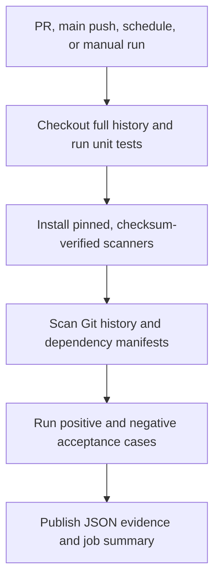

# CI/CD Security Scanning Pipeline — Project Report

**Author:** Kushwanth Avutapalli  
**Project type:** Security engineering portfolio lab  
**Verification date:** November 11, 2026  
**Technology:** GitHub Actions, Gitleaks, Trivy, Python, Bash

## Executive assessment

The pipeline is operational in GitHub Actions. The verified main-branch run completed secret scanning, dependency scanning, five unit tests, six scanner acceptance cases, and report upload successfully. Pull-request runs also completed successfully. The implementation demonstrates automated detection and documented response procedures in a controlled lab.

The sample application is dependency-free. A temporary manifest containing Django 2.2.0 validates vulnerability detection; it produced 22 HIGH/CRITICAL findings at verification time. These are deliberately seeded fixture findings, not vulnerabilities in a deployed application. No live credentials or vulnerable packages were used or installed.

## Objective and scope

Identify credential exposure and vulnerable dependencies early in code review, give reviewers usable evidence, and validate that both positive and negative inputs produce the expected outcomes.

| Requirement | Implementation | Evidence |
| --- | --- | --- |
| Scan pull requests | GitHub Actions `pull_request` trigger | Successful PR runs |
| Detect credential patterns | Gitleaks default rules across fetched Git history | Production scan and seeded acceptance case |
| Detect vulnerable dependencies | Trivy filesystem vulnerability scanner | Temporary Django manifest produces findings |
| Fail on security findings | Scanner findings use exit 10; nonzero production steps fail the job | Shell configuration and regression tests |
| Validate false-positive handling | Temporary exception restricted by rule, path, and exact value | Exception case plus a different-value negative control |
| Preserve review evidence | Redacted secret JSON, vulnerability JSON, acceptance summary | Uploaded `security-reports` artifact |
| Document response | Triage and credential rotation runbooks | Reviewed repository documentation; procedures not exercised on real accounts |

This scope does not include SAST, DAST, container image scanning, infrastructure scanning, automatic remediation, deployment, or production incident response.

## Design and execution flow

The job runs on an ephemeral Ubuntu 24.04 runner with a 20-minute timeout. Its token has `contents: read`; checkout does not persist credentials. No application secrets or deployment credentials are passed to the job. Both scan steps use a condition that allows execution after an earlier failure unless the run is cancelled, and evidence upload uses `always()`.

The workflow runs on PR events, pushes to main, manual dispatch, and Mondays at 08:23 UTC. Concurrent runs for the same Git reference cancel older runs.

## Scanner configuration and policy

### Secrets

Gitleaks 8.30.1 scans the checked-out repository history using the default rule set extended by `.gitleaks.toml`. Checkout fetches full history. Reports use 100% redaction. The project introduces no production-specific allowlist; built-in vendor allowlists still apply.

The acceptance harness assembles synthetic AWS-shaped identifiers only in temporary directories. The exception test creates an isolated configuration with an AND condition on path and value for the relevant rule. A different identifier in the same file must remain detectable.

### Dependencies

Trivy 0.76.1 scans recognized repository manifests for HIGH and CRITICAL vulnerabilities. Findings without a fix are included. `.git`, local tool binaries, and generated reports are excluded from filesystem traversal. The database is obtained at run time, so results can change as advisories are updated.

The example app has no third-party runtime dependencies. A clean app scan alone cannot prove dependency detection; the temporary Django manifest supplies the positive control.

### Tool integrity

The installer downloads official Linux x86_64 release archives and compares each archive with a SHA256 digest pinned in source. This detects later archive changes relative to the reviewed digest. It is not independent build-provenance verification. Scanner upgrades require release review, digest updates, and acceptance testing. Dependabot handles GitHub Actions updates separately.

## Verification results

Verified commit: `ecf3e6bd6cc3785b6b68310a6a0e207347d9ade8`.

[Main-branch evidence](https://github.com/Kushwanth958/CI-CD-Security-Scanning-Pipeline/actions/runs/43076344167) · [Pull-request evidence](https://github.com/Kushwanth958/CI-CD-Security-Scanning-Pipeline/actions/runs/43076230531)

| Test | Observed outcome | Interpretation |
| --- | --- | --- |
| Unit tests | 5 passed | Expected findings, operational errors, invalid modes, and scan orchestration behave as asserted |
| Full-history secret scan | Passed; no leaks found | No credential patterns were reported in the scanned history |
| Repository dependency scan | Passed | Dependency-free example has no package findings |
| Gitleaks clean fixture | 0 findings; expected exit 0 | Benign configuration passes |
| Gitleaks seeded fixture | 1 finding; expected exit 10 | Synthetic credential pattern is detected |
| Exact exception | Expected exit 0 | Scoped exception is honored |
| Different value, same file | Expected exit 10 | Exception does not hide other matching credentials |
| Trivy clean fixture | 0 findings; expected exit 0 | Clean target passes |
| Trivy Django fixture | 22 findings; expected exit 10 | Known vulnerable package is detected |
| Evidence publication | Successful | Three JSON reports uploaded |

Acceptance tests succeed when the seeded threat is detected with the expected exit code; this does not turn a failing production scan into a pass. Unexpected tool errors fail the harness. Unit tests use isolated mock commands and do not substitute for real-scanner acceptance tests.

A [structured evidence summary](evidence/verification-2026-11-11.json) preserves the observed outcomes and source run identifiers. It is explicitly a curated summary, not a raw scanner report. Raw JSON reports are downloadable from the run for seven days under the current retention setting.

## Findings and response process

For suspected secrets, record redacted evidence, identify the owner, revoke or rotate the credential, update consumers, and review provider audit logs for misuse. Removing a value from source does not revoke it. Full-history detections require coordinated history cleanup or a reviewed exact historical exception after response is complete.

For dependencies, confirm the package, installed version, advisory, and affected range; update the manifest and lockfile together, run application tests, and rescan. Exceptions require an owner, rationale, approval, compensating controls, and expiry. This lab documents that process but does not automatically enforce exception expiry.

See [alert triage](triage.md) and [credential rotation](credential-rotation.md) for the full procedures.

## Operational readiness and limitations

| Area | Current position | Follow-up when adopting in production |
| --- | --- | --- |
| Merge enforcement | Failed checks are reported; a required-check ruleset was not configured | Require **Security checks** on main and review bypass permissions |
| Detection coverage | Pattern-based secret detection and recognized dependency manifests | Review supported ecosystems, transitive coverage, and unpinned manifests |
| Application assurance | Minimal dependency-free demonstration | Add meaningful application tests for a real service |
| Availability | Release assets and vulnerability database require outbound access | Treat download/DB failures as operational failures; investigate rather than suppress |
| Evidence retention | Raw artifacts retained seven days | Define an approved retention and access policy |
| Exceptions | Documented; no automated expiry enforcement | Implement reviewed, time-limited exception governance |
| Workflow dependencies | Action commits and scanner archives are pinned | Review update PRs and scanner releases regularly |
| Provider response | Rotation procedure documented | Exercise only with authorized test credentials in a designated account |

A passing workflow establishes the tested behavior for the scanned inputs. It does not establish that all vulnerabilities or secrets are absent, that a failed PR has been experimentally blocked by branch protection, or that real credential rotation has occurred.

## Reproduction and handover

Use [the operations guide](operations.md) for setup, commands, expected exit behavior, evidence retrieval, and troubleshooting. Use [the file inventory](file-inventory.md) to locate each implementation and documentation artifact. The [demonstration guide](demo.md) provides a review and interview walkthrough.

The verified baseline is suitable for demonstrating PR security scanning, safe seeded detection tests, failure handling, and response documentation. Enforced merge policy and production-specific controls remain explicit adoption tasks.
